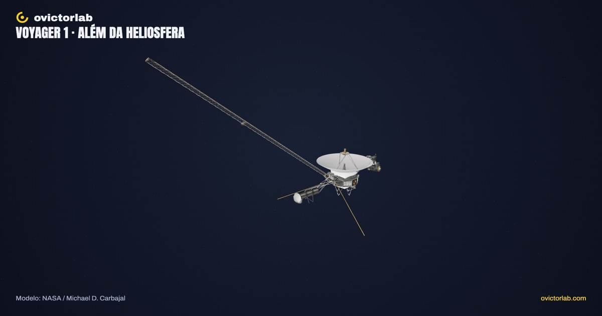
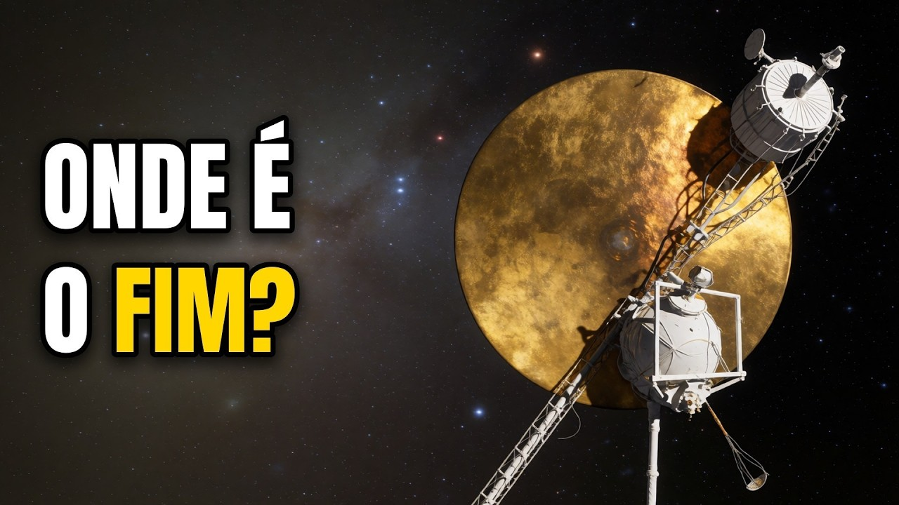

# Voyager 1 explorável

**[Abrir a experiência →](https://victorsodre.github.io/voyager/)** · [Os 10 experimentos](docs/COLECAO.md) · [Publicação e manutenção](docs/PUBLICACAO.md)

[](https://victorsodre.github.io/voyager/)

**O que a Voyager carrega e até onde sua viagem chegou?**

Gire o modelo oficial da NASA, selecione um dos sete conjuntos, isole e aproxime seus instrumentos. Depois, explore seis marcos da viagem em uma vista separada, que preserva a câmera e a seleção da sonda.

Direção editorial: **Victor Sodré / ovictorlab**. [Site](https://ovictorlab.com/) · [Referência Fusquinha](https://victorsodre.github.io/fusquinha/) · [Repositório](https://github.com/victorsodre/voyager).

## Entenda no vídeo

<a href="https://www.youtube.com/watch?v=PyF4PO5zPpk"></a>

**[Onde termina o sistema solar? (a Voyager 1 ainda não chegou lá)](https://www.youtube.com/watch?v=PyF4PO5zPpk)**

Do lançamento aos limites do sistema solar: acompanhe a explicação e volte à sonda para conhecer seus instrumentos.

O player incorporado fica [na página do experimento](https://victorsodre.github.io/voyager/#video), com carregamento por clique e sem reprodução automática.

## Rodar e verificar

Node.js 22.18 ou superior. Versões e lockfile fixados; execução validada com Node 26.7.0 e npm 11.19.0.

```sh
npm ci --ignore-scripts
npm run dev
npm run check
npm test
npm run build
npm run preview
```

`npm run build` gera `dist/`, com base relativa para hospedagem em subpasta. A aplicação funciona no navegador, sem backend, LLM ou GPU de produção alocada. O diretório inteiro `dist/`, incluindo modelos, decodificador e licenças, faz parte da entrega.

## Implementado

- Sete conjuntos reais: antena, corpo, plataforma científica, magnetômetro, RTGs, antenas de plasma e capa do disco dourado.
- Órbita, zoom (Ctrl + rolagem ou dois dedos), seleção por clique/lista, busca, isolamento, aproximação e reset. A rolagem da página não fica presa no 3D.
- Tour da sonda, malha e exportação PNG em 1920×1080 ou 1080×1920, com créditos.
- Viagem por seis marcos, com passos, reprodução, pausa, barra de progresso e fontes.
- Interface pt-BR responsiva, teclado, movimento reduzido e fallback de rede/WebGL.

A viagem é um esquema cronológico sem escala orbital ou temporal. Identifica Voyager **1**; Urano/Netuno pertencem à rota da Voyager 2. O marco de um dia-luz usa a data calculada pela NASA (**18/11/2026**): até lá aparece como previsão; depois, como "por volta de 18/11/2026". Não é telemetria. Magnetômetro e antenas de ondas de plasma aparecem como **ainda ligados**, conforme a NASA em 17/04/2026. Não há desmontagem fictícia, interior inventado ou áudio automático.

## Modelo e créditos

[Voyager Probe (B)](https://science.nasa.gov/3d-resources/voyager-probe-b/), **NASA / Michael D. Carbajal**. GLB original preservado: 1.720.864 bytes, 20.390 triângulos. A aplicação reúne componentes inteiros em conjuntos semânticos. NASA não endossa este projeto. [Aquisição e licenças](docs/ASSETS-E-FONTES.md).

## Guias

1. [Escopo](docs/ESCOPO.md) e [execução](docs/EXECUCAO.md).
2. [Identidade visual](docs/IDENTIDADE-VISUAL.md).
3. [Arquitetura implementada](docs/ARQUITETURA.md).
4. [Apuração](docs/APURACAO.md), [geometria](docs/GEOMETRIA.md) e [inventário](docs/ASSET-INVENTARIO.json).
5. [Manutenção](docs/MANUTENCAO.md), [validação](docs/VALIDACAO.md) e [decisões](docs/DECISOES.md).
6. [Rascunhos para o X](POSTAGENS-X.md) e [coleção](docs/COLECAO.md).

## Origem da pauta

[Reel sobre o Sistema Solar](https://www.instagram.com/reel/DeJ2_AOKGiG/): 101.418 visualizações. [Vídeo longo da Voyager](https://www.youtube.com/watch?v=PyF4PO5zPpk): 1.085 visualizações; relatório de 06/11/2026 registrou 47,72% de duração média assistida. Consulta em 07/11. São conteúdos distintos do mesmo tema; suas métricas não comprovam uso deste aplicativo.

Aplicação publicada no GitHub Pages, com vídeo incorporado e links conferidos. Os rascunhos de divulgação permanecem em [POSTAGENS-X.md](POSTAGENS-X.md), para publicação manual por Victor.
